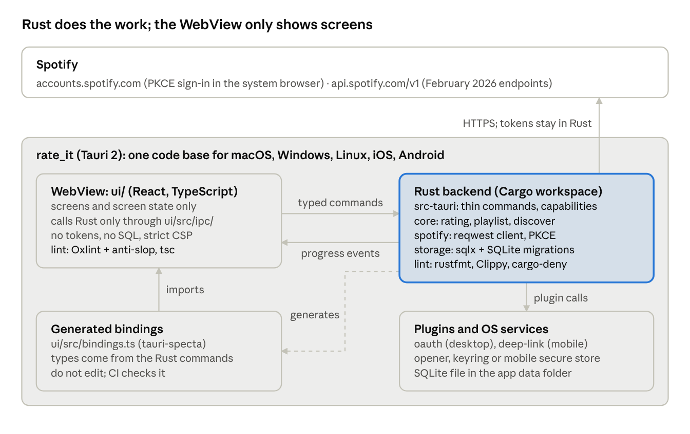

# rate_it — Tauri 2 Migration Spec

Nov 5, 2026 · Kevin Land

> Master copy of this spec. Live, editable version: <https://claude.ai/artifact/RWPVT8wJxJ62gQc1yv8GjJ>.
> If the two differ, update this file in the same commit as the change it describes.

## Summary

Build rate_it again with Tauri 2. One app runs on macOS, Windows, Linux, iOS and Android. The user interface is React and TypeScript. The backend is Rust: it holds the Spotify client, the tokens, the SQLite database and the rating logic. Two linter sets check the code: Oxlint with anti-slop for TypeScript, and rustfmt, Clippy and cargo-deny for Rust.

Three decisions come from your request. Read them before the rest of this spec:

1. **Tauri 2 replaces Electron and Capacitor.** One framework makes the desktop app and the mobile app. The two shells of the previous version of this spec are gone.
2. **spotipy cannot run in this app.** spotipy is free (MIT), but it is Python. The Rust library with the same function, rspotify (MIT), did the February 2026 changes. But it went into maintenance mode in March 2026. Thus port your own client to Rust.
3. **Spotify changed the Web API in February 2026.** For Development Mode apps, Spotify removed the artist top tracks endpoint and the batch album endpoint, and moved the playlist endpoints. The Top 10, discography and playlist functions need changes (see Feature parity).

This spec also corrects the 18 findings of the code review. The text uses ASD-STE100 Simplified Technical English at 80% conformance.

## Goals and non-goals

**Goals**

- The desktop app operates on macOS, Windows and Linux. The mobile app operates on iOS and Android.
- All functions of the Python app operate, or the spec gives a replacement.
- No rating is lost. A rating keeps its history.
- The user links the Spotify account one time. The token refresh is automatic.
- The TypeScript code and the Rust code pass strict lint rules, type checks and tests before each merge.

**Non-goals for version 1**

- Sync of ratings between devices. Each device has its own database. Export and import of a JSON file move ratings between devices.
- A server or a user account other than Spotify.
- Publication to the App Store or Google Play. Spotify Development Mode permits only 5 users (see Open questions).

## Platform and stack

The Rust backend does all the work. The TypeScript side shows screens and calls typed Rust commands. The WebView never receives a token and never runs SQL.

| Area | Choice | Reason |
| --- | --- | --- |
| App framework | Tauri 2 | One framework for desktop and mobile. It uses the system WebView, so the app is small. |
| User interface | React, TypeScript (`strict`), Vite | Screens and screen state only. No business logic. |
| Backend | Rust, in a Cargo workspace | Holds the Spotify client, the tokens, the database and the rating logic. |
| Typed IPC | `tauri-specta` (MIT) | Makes TypeScript types and functions from the Rust commands. Version 2 is a release candidate (`2.0.0-rc.21`). Fallback: write the bindings by hand. |
| Spotify client | Your own client in Rust, with `reqwest` | See Spotify client. |
| Database | SQLite through `sqlx`, with `sqlx::migrate!` | One code path on all five platforms. Not `tauri-plugin-sql`, because that plugin gives SQL access to the WebView. |
| Desktop sign-in | `tauri-plugin-oauth` (MIT or Apache 2.0) | Starts a temporary loopback server for the OAuth redirect. |
| Mobile sign-in | Official `deep-link` and `opener` plugins | The system browser opens Spotify. A deep link brings the code back. |
| Token storage | `keyring` crate (MIT or Apache 2.0) on desktop | Keychain, Credential Manager, Secret Service. Mobile storage is an open question. |
| TypeScript lint | Oxlint + anti-slop, `tsc`, dependency-cruiser, knip, Prettier | See Code quality. |
| Rust lint | rustfmt, Clippy, cargo-deny, cargo-machete | See Code quality. |
| Tests | Vitest with `mockIPC`, cargo-nextest, wiremock, WebDriver | See Testing and CI. |

## Architecture

The same Tauri app runs on all five platforms. The Rust backend holds the tokens, the database and the Spotify calls. The WebView gets only typed commands and progress events.



The generated bindings connect the two languages. When a Rust command changes, CI makes the bindings again and fails if `ui/src/bindings.ts` is different. Only the plugins are different between desktop and mobile: `oauth` on desktop, `deep-link` on mobile.

## Spotify client

Port your own client to Rust as the `spotify` crate. Use `reqwest`. Use the spotipy design as a reference only.

| Option | License | Result |
| --- | --- | --- |
| [spotipy](https://github.com/spotipy-dev/spotipy) 2.26.0 | MIT (free) | Not possible. It is Python. It cannot run in the Rust backend or on a phone. |
| [rspotify](https://github.com/ramsayleung/rspotify) | MIT (free) | Possible, but not recommended. It did the February 2026 changes in March 2026. Then it went into maintenance mode: no new features and no active tests. |
| Your own client, in Rust | Yours | **Selected.** The app uses approximately 12 endpoints. You control each one, and you can correct it when Spotify changes the API again. |

The client must:

1. Use one `reqwest::Client` with a timeout of 10 seconds. Use the `rustls` TLS feature, so mobile builds need no OpenSSL.
2. Return `Ok(None)` for HTTP 204.
3. On HTTP 401, refresh the token one time and send the request again (F1).
4. On HTTP 429, wait for the time in the `Retry-After` header. Send no more than 3 retries.
5. Deserialize each response into a `serde` struct. Return one error type, `SpotifyError` (made with `thiserror`), with the status and the endpoint (F2). Never call `unwrap()` on a response.
6. Limit parallel requests to 4 with a `tokio::sync::Semaphore`.
7. Use the endpoints that the [February 2026 migration guide](https://developer.spotify.com/documentation/web-api/tutorials/february-2026-migration-guide) gives:

| Old call in the Python app | New call |
| --- | --- |
| `GET /albums?ids=` (batch) | `GET /albums/{id}`, one request per album |
| `POST /users/{user_id}/playlists` | `POST /me/playlists` |
| `POST /playlists/{id}/tracks` | `POST /playlists/{id}/items` |
| `GET /artists/{id}/top-tracks` | Removed. No replacement (see Feature parity). |
| `album_group` field filter | Field removed. Use `include_groups=album,single` in the request. |
| Market `"US"` (hard-coded) | `market=from_token`. The `country` field of `GET /me` is removed. |

This table corrects one recommendation in the code review. The review said: get the market from the profile `country`. That field is no longer available.

## Authorization

Use the Authorization Code flow with PKCE on all platforms. The Rust backend does all steps. Do not put the client secret in the app. Send a random `state` value and check it in the callback (F11).

**Desktop (macOS, Windows, Linux)**

1. Rust makes the PKCE verifier, the challenge and the `state` value.
2. `tauri-plugin-oauth` starts a temporary server on a free port. Use the redirect URI `http://127.0.0.1:<port>/callback`. Spotify permits a port that changes for loopback IP addresses. Spotify does not permit `localhost`.
3. The `opener` plugin opens the Spotify sign-in page in the system browser. Open only the fixed Spotify URL.
4. The callback gives the code to Rust. Rust checks `state`, gets the tokens and stops the server.
5. Rust keeps the refresh token with the `keyring` crate. The access token stays in Rust memory only.

**Mobile (iOS, Android)**

1. The `opener` plugin opens the sign-in page in the system browser.
2. Spotify sends the user back to a redirect URI. The `deep-link` plugin gives that URI to Rust.
3. First, test a custom scheme such as `rateit://callback`. It needs no server. The [Spotify redirect URI rules](https://developer.spotify.com/documentation/web-api/concepts/redirect_uri) permit HTTPS, or HTTP on loopback only, and do not mention custom schemes.
4. If Spotify refuses the custom scheme, use an HTTPS App Link (Android) and Universal Link (iOS). These need a domain that you own, with `assetlinks.json` and `apple-app-site-association` files.
5. Rust checks the deep link URL before use. A deep link can come from another app.

The scopes are the same as in the Python app, less `user-read-email` and `user-read-recently-played`. The app does not use them.

## Data

Keep the ratings in SQLite. Use Spotify IDs as keys (F13). Never update or delete a rating row: a new rating adds a new row, so the history stays.

```sql
-- crates/storage/migrations/0001_initial.sql
CREATE TABLE artists (
  id   TEXT PRIMARY KEY,          -- Spotify artist ID
  name TEXT NOT NULL
);

CREATE TABLE tracks (
  id         TEXT PRIMARY KEY,    -- Spotify track ID
  name       TEXT NOT NULL,
  album_id   TEXT,
  album_name TEXT
);

CREATE TABLE track_artists (
  track_id  TEXT NOT NULL REFERENCES tracks(id),
  artist_id TEXT NOT NULL REFERENCES artists(id),
  position  INTEGER NOT NULL,     -- 0 = main artist
  PRIMARY KEY (track_id, artist_id)
);

CREATE TABLE ratings (
  id       INTEGER PRIMARY KEY,
  track_id TEXT NOT NULL REFERENCES tracks(id),
  rating   INTEGER NOT NULL CHECK (rating BETWEEN 1 AND 10),
  rated_at TEXT NOT NULL DEFAULT (strftime('%Y-%m-%dT%H:%M:%fZ', 'now')),
  source   TEXT NOT NULL CHECK (source IN ('app', 'import'))
);
CREATE INDEX ratings_track ON ratings(track_id, id);

-- The last rating of each track
CREATE VIEW current_ratings AS
SELECT r.* FROM ratings r
WHERE r.id = (SELECT MAX(id) FROM ratings WHERE track_id = r.track_id);

CREATE TABLE schema_migrations (
  version    INTEGER PRIMARY KEY,
  applied_at TEXT NOT NULL
);
```

Rules for the `storage` crate:

- Use `sqlx` with the `sqlite` and `runtime-tokio` features. Keep the database file in the Tauri app data folder on each platform.
- Put each schema change in a new numbered SQL file in `migrations/`. `sqlx::migrate!` adds the files to the binary and runs them in order at start.
- Use the `sqlx::query!` macros, so the compiler checks each query against the schema. Commit the `.sqlx/` folder, so CI builds without a database.
- Turn on foreign keys and WAL mode in the connection options.
- Write each rating in one transaction. SQLite then gives the atomic write that `rate.txt` did not have (F3).
- The rest of the code uses only the `RatingsRepository` trait. It never uses SQL directly.

**One-time import from `rate.txt`**

The current file has 4 artists and 5 ratings. The file has no artist IDs and no dates. Do the import on desktop, from the Settings screen:

1. The user selects `rate.txt`. Rust parses it into `serde` structs. If the parse fails, the app stops and shows the error. It changes nothing.
2. For each track ID, the app calls `GET /tracks/{id}` to get the artist IDs and the album. The batch track endpoint is removed, so send one request per track.
3. If a track is not found, the app uses the artist name from the file, with the ID `legacy:<artist name>`.
4. The app writes all rows in one transaction, with `source = 'import'` and the import time as `rated_at`.
5. The app skips a track that has a rating already. Thus a second import adds nothing.
6. The app shows a report: the number of imported, skipped and failed tracks. It does not change or delete `rate.txt`.

To move ratings to a phone, use Settings > Export on desktop and Settings > Import on mobile. The export is a JSON file of all rows in the `ratings` table, with track and artist data.

## Feature parity

Each current page becomes one screen. All functions stay, except Top 10. Top 10 needs a decision, because Spotify removed its endpoint.

| Current page | New screen | Changes | Findings fixed |
| --- | --- | --- | --- |
| Home: 10 stars and log | Now Playing | Stars 1-10 for the current song. The log reads the last 10 ratings from SQLite, so it stays after a restart. Shows "Nothing playing" for HTTP 204. | F2, F16 |
| Ratings | Library | All ratings by artist, sorted by rating. Change a rating in place; the old rating stays in the history. Input accepts 1-10 only. | F13, F17 |
| Current Artist | Artist | Average rating, rated count / total count, top 5 songs. Each Play button sends `spotify:track:<id>` for its own song. | F4, F6 |
| Share | Share | Song card and album card. On mobile, use the native share sheet. On desktop, copy an image of the card. | F4, F9 |
| Playlist | Build Playlist | Select artists and a minimum rating 1-10. Name field is trimmed and required. Uses `POST /me/playlists` and `/items`. | F5, F8, F14 |
| Related Artists | Collaborators | One `GET /albums/{id}` per album, with no more than 4 parallel requests. Shows progress, and has a Cancel button. Keeps results in a cache table. | F10, F15 |
| Discover: Full Discography, Unrated, Album | Discover | Keys by track ID, not by name. Unrated mode removes rated songs by ID. | F7, F10, F12 |
| Discover: Top 10 | Decision needed | Spotify removed `GET /artists/{id}/top-tracks`. Recommended replacement: "My Top 10", the 10 songs of the artist with your highest ratings. | — |
| Link Account button | Sign-in and Settings | PKCE sign-in one time. Settings has Import, Export and Sign out. | F1, F11 |

All Spotify calls run in `async` Rust commands, outside the user interface thread (F10). Each screen shows a loading state while a command runs. Long commands (Collaborators, Discover) send progress events to the screen and accept a cancel command. The mobile share sheet uses the community `tauri-plugin-sharesheet`.

## Code quality

The project has two lint gates: one for the TypeScript user interface and one for the Rust backend. `pnpm check` runs both. A failure in either gate stops the merge.

| Gate | Tool | What it stops |
| --- | --- | --- |
| TypeScript | Oxlint + [anti-slop](https://github.com/dmmulroy/anti-slop) | Weak types, unsafe casts, AI-generated patterns, `console` calls, import cycles |
| TypeScript | `tsc --noEmit` (strict) | Type errors such as F4 and F5 |
| TypeScript | dependency-cruiser | Direct `invoke()` calls outside the generated bindings |
| TypeScript | knip | Unused files, exports and packages (F18) |
| TypeScript | Prettier | Format differences |
| Rust | rustfmt | Format differences |
| Rust | Clippy | Panics, `unwrap()`, debug output, long functions, unsafe code |
| Rust | cargo-deny | Security advisories, licenses that are not permitted, unknown sources |
| Rust | cargo-machete | Unused dependencies |

The configuration files are in the repository root and in `ui/`. See `LINTING.md` for the file list and the commands.

### TypeScript linter

anti-slop is a set of Oxlint rules (MIT). It has no npm package. Copy its `src/` folder into `tools/anti-slop/`, and install `@oxlint/plugins` at the same Oxlint version. Or run its install skill: `npx skills add dmmulroy/anti-slop --skill install-anti-slop`. The skill merges the plugin entry into the config. Make sure that the keys in `ui/.oxlintrc.json` agree with what the skill writes.

- Config: `ui/.oxlintrc.json`, `ui/tsconfig.json`, `.dependency-cruiser.cjs`, `knip.json`, `.prettierrc.json`.
- Dependency-cruiser rule: only `ui/src/ipc/` may import `@tauri-apps/api` or `src/bindings.ts`. All screens call typed functions from `ui/src/ipc/`.
- Do not turn on the anti-slop Effect rules. The app does not use Effect. If a generic rule blocks a correct pattern (for example, React props and `no-object-parameters`), turn it off for those files only, with a comment that gives the reason.

### Rust linter

Put the lint levels in the workspace `Cargo.toml`. Each crate adds `[lints] workspace = true`. Clippy's default groups stay on. Add `pedantic`, and pick restriction lints one by one, as the [Clippy documentation](https://doc.rust-lang.org/clippy/lints.html) recommends.

- Config: `Cargo.toml` (`[workspace.lints]`), `clippy.toml`, `rustfmt.toml`, `deny.toml`, `rust-toolchain.toml`.
- When a lint must stay off for one item, use `#[expect(clippy::lint_name, reason = "...")]`. The lint `allow_attributes_without_reason` refuses an `allow` with no reason.

Run the Rust gate with:

```bash
cargo fmt --all --check
cargo clippy --workspace --all-targets --all-features -- -D warnings
cargo deny check
cargo machete
```

### Folder structure

```text
rate-it/
  ui/                   React + TypeScript (screens only)
    src/ipc/            The only code that calls Rust
    src/bindings.ts     Generated by tauri-specta. Do not edit.
  src-tauri/            Tauri app crate: commands, plugins, capabilities
    capabilities/       Permissions for each window
  crates/
    core/               Rating, playlist and discover services
    spotify/            Spotify client and PKCE
    storage/            sqlx repository and migrations/
  tools/anti-slop/      Vendored Oxlint rules
  Cargo.toml            Workspace and lint levels
  AGENTS.md             Rules for AI coding agents
```

The dependency direction is `src-tauri` → `core` → (`spotify`, `storage`). Commands in `src-tauri` are thin: they check input and call `core`. `core` gets the client and the repository as trait objects, so tests can give fakes.

### Tauri security

- Give the main window only the permissions it needs, in `src-tauri/capabilities/`. The [Tauri security model](https://v2.tauri.app/security/) blocks plugin commands until a capability permits them.
- Set a Content Security Policy with `script-src 'self'`.
- Do not give the WebView the `sql`, `fs` or `shell` permissions. Only the Rust commands touch the disk and the network.
- Check all command input in Rust. Treat it as untrusted.

### Rules for AI-generated code

The rules are in `AGENTS.md`, so that each coding agent reads them.

## Testing and CI

Test the Rust logic without the network, and the screens without Rust. The Python app had no tests.

| Level | Tool | What it tests |
| --- | --- | --- |
| Rust unit | cargo-nextest | `core` services with fake `SpotifyClient` and `RatingsRepository` traits |
| Rust storage | cargo-nextest + in-memory SQLite | All migrations, the `current_ratings` view, the `rate.txt` import (including a second import that adds nothing) |
| Rust Spotify client | cargo-nextest + `wiremock` | HTTP 204, 401 with refresh, 429 with `Retry-After`, timeout, an incorrect response shape |
| TypeScript screens | Vitest + Testing Library + `mockIPC` from `@tauri-apps/api/mocks` | Each screen with fake command results. No module mocking (anti-slop rule). |
| Desktop end-to-end | WebDriver with `tauri-driver` | Sign-in with a fake Spotify server, rate a song, rate it again, build a playlist |
| Mobile | Manual smoke test on one iOS and one Android device | Sign-in, rate, import, share |

GitHub Actions runs on each push and pull request:

1. TypeScript gate: `pnpm install --frozen-lockfile`, Oxlint with anti-slop, `tsc`, dependency-cruiser, knip, Prettier check, Vitest.
2. Rust gate: `cargo fmt --check`, `cargo clippy -- -D warnings`, `cargo deny check`, `cargo machete`, `cargo nextest run`.
3. A check that `ui/src/bindings.ts` is the same as a new generation from Rust.
4. WebDriver end-to-end tests on Linux.
5. Tauri builds for macOS, Windows and Linux, and test builds for Android and iOS (on the `main` branch only).

A pull request cannot merge if a step fails.

## Migration plan

Do the work in six phases. Do not start a phase before the exit criteria of the previous phase are true. Keep the Python app in use until Phase 5.

1. **Phase 0 — Set up.** Answer the open questions. Make the Tauri 2 project, the Cargo workspace, both lint gates and the CI pipeline. Register the redirect URIs in the Spotify dashboard.
   - Exit: CI passes on an empty app. A test file with a known anti-slop violation fails the TypeScript gate. A test `unwrap()` fails the Rust gate.
2. **Phase 1 — Storage and import.** Write the migrations, the `storage` crate and the `rate.txt` import.
   - Exit: the import of the current `rate.txt` gives 5 ratings for 4 artists. A second import adds 0 rows.
3. **Phase 2 — Spotify client and desktop sign-in.** Write the Rust client, PKCE, token refresh and `keyring` storage.
   - Exit: the app makes requests for more than 1 hour without a new sign-in. The tests for 204, 401 and 429 pass.
4. **Phase 3 — Desktop screens.** Build all screens in the Feature parity table, with typed commands.
   - Exit: each row of the table operates on macOS, Windows and Linux. WebDriver tests pass.
5. **Phase 4 — Mobile.** Add the iOS and Android targets, mobile sign-in with deep links, mobile token storage, and export and import between devices.
   - Exit: sign-in, rating and import operate on one iOS device and one Android device.
6. **Phase 5 — Retire the Python app.** Use only the new app for one week.
   - Exit: no data loss and no open high-severity defects. Then move the Python code to a `legacy` tag.

## Open questions

- [ ] **Spotify client.** Do you accept your own Rust client? The other choice is rspotify (MIT), which is in maintenance mode.
- [ ] **Mobile token storage.** Tauri has no official keychain plugin. Use a community plugin for the iOS Keychain and the Android Keystore, or the official Stronghold plugin (an encrypted file)? Test the `keyring` crate on mobile first.
- [ ] **tauri-specta.** Version 2 is still a release candidate. Accept it, or write the TypeScript bindings by hand?
- [ ] **Top 10.** Replace it with "My Top 10" from your ratings, or remove it?
- [ ] **Mobile redirect URI.** Does Spotify accept a custom scheme such as `rateit://callback`? If not, do you have a domain for App Links and Universal Links?
- [ ] **Users.** Development Mode permits 5 users, and the app owner must have Spotify Premium. Is that enough?
- [ ] **Sync.** Is export and import of a file enough to move ratings between desktop and phone in version 1?

## Sources

- [Tauri 2 plugins](https://v2.tauri.app/plugin/), [deep linking](https://v2.tauri.app/plugin/deep-linking/), [SQL plugin](https://v2.tauri.app/plugin/sql/) and [security model](https://v2.tauri.app/security/).
- [tauri-specta](https://github.com/specta-rs/tauri-specta): MIT, Tauri 2 support in `2.0.0-rc.21`.
- [tauri-plugin-oauth](https://github.com/FabianLars/tauri-plugin-oauth): MIT or Apache 2.0, loopback OAuth server for desktop.
- [keyring crate](https://docs.rs/keyring/latest/keyring/) 4.2.0: MIT or Apache 2.0. [keyring-rs repository](https://github.com/open-source-cooperative/keyring-rs): platform stores in separate crates.
- [Clippy lint groups](https://doc.rust-lang.org/clippy/lints.html): default levels and `[lints]` configuration.
- [anti-slop repository](https://github.com/dmmulroy/anti-slop): Oxlint plugin, MIT, rule list, install steps.
- [spotipy repository](https://github.com/spotipy-dev/spotipy) and [changelog](https://github.com/spotipy-dev/spotipy/blob/master/CHANGELOG.md): MIT, Python, version 2.26.0.
- [rspotify repository](https://github.com/ramsayleung/rspotify) and [issue 550](https://github.com/ramsayleung/rspotify/issues/550): MIT, February 2026 changes done, maintenance mode since 2026-03-16.
- [Spotify February 2026 migration guide](https://developer.spotify.com/documentation/web-api/tutorials/february-2026-migration-guide): removed and renamed endpoints, 5-user limit, Premium requirement.
- [Spotify redirect URI rules](https://developer.spotify.com/documentation/web-api/concepts/redirect_uri): loopback IP literals, no `localhost`.
